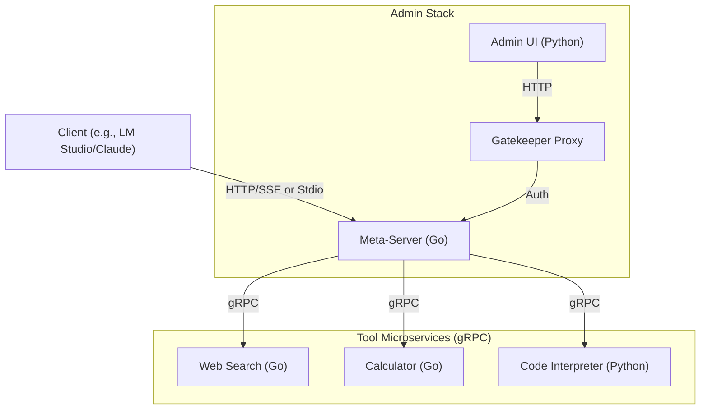

<p align="center">
  
</p>

# MCP-NG: Model Context Protocol - Next Generation

[](https://opensource.org/licenses/MIT)
[](https://go.dev/)
[](https://www.python.org/)
[](https://github.com/psf/black)

MCP-NG is a high-performance, modular implementation of the [Model Context Protocol](https://modelcontextprotocol.io), designed for scalability, security, and polyglot extensibility.

Unlike standard single-process servers, MCP-NG uses a **Meta-Server** architecture that orchestrates multiple isolated tool microservices over gRPC, exposing them as a unified MCP endpoint (HTTP/SSE or Stdio).

## 🚀 Key Features

*   **⚡ Go-Based Core:** High-performance Meta-Server and Agent.
*   **🔌 Polyglot Tools:** Native support for tools written in **Go** and **Python**.
*   **🛡️ Security First:** Admin Gatekeeper, OAuth 2.0 support, and isolated tool processes.
*   **🌐 Multi-Transport:** Supports both **HTTP (SSE)** and **Stdio** transports simultaneously.
*   **🔧 Hot Reload:** Add, update, or remove tools at runtime without restarting the server.

## ⚡ Performance

MCP-NG is built for speed. Benchmarks on a standard 4-vCPU server demonstrate:

*   **7,000+ RPS** throughput for Go-based tools.
*   **< 2ms** average latency for single requests.
*   **Zero errors** under high concurrency (100+ simultaneous clients).

[View full Performance Report](docs/PERFORMANCE.md)

## 📦 Architecture



## 🛠️ Installation

### Prerequisites
*   **Go 1.23+**
*   **Python 3.12+** with **Poetry**
*   **Git**
*   **Docker** (optional, for containerized run)

### 🐳 Docker (Easiest)
Run the server in a container without installing Go or Python locally.

```bash
docker-compose up --build
```
The server will be available at `http://localhost:8080` (HTTP) and `http://localhost:7860` (Admin UI).

### ⚡ One-Click Install (Recommended)
Get everything running (Server + Admin UI + Tools) in one command.

**Linux/macOS:**
```bash
git clone https://github.com/your-repo/MCP-NG.git
cd MCP-NG
./full_install.sh
```

**Windows:**
```bat
git clone https://github.com/your-repo/MCP-NG.git
cd MCP-NG
full_install.bat
```

### Manual Build
If you prefer to build only the core components:
```bash
./setup/build.sh  # Linux/macOS
setup\build_windows.bat # Windows
```

## 🏃 Usage

### Running the Meta-Server
The server manages all tools. It can run in HTTP mode (for remote clients) or Stdio mode (for local integration).

**HTTP Mode (Default):**
```bash
./MCP-NG/bin/server --transport=http --http-port=8080
```

**Stdio Mode:**
```bash
./MCP-NG/bin/server --transport=stdio
```

### Direct Tool Usage (Stdio)
You can run individual tools directly in `stdio` mode for testing or integration without the full server.

**Requirements:**
*   You must provide the API key (if required) via a file flag.
*   Input must be framed with `Content-Length` headers (standard MCP Stdio protocol).

**Example (web_search_simple):**
```bash
# 1. Create secret file
echo "your-api-key" > env/SERPER_API_KEY

# 2. Run tool
./MCP-NG/bin/web_search_simple --transport=stdio --serper_api_key-from-file=env/SERPER_API_KEY
```

**Note:** Tools expect persistent connections. Testing via `echo` requires careful handling of pipes to avoid closing `stdin` prematurely.

### Connecting Clients
*   **LM Studio:** Point to `http://localhost:8080` (SSE).
*   **Claude Desktop:** Configure to run the server binary in `stdio` mode.

## 🖥️ Admin UI

The project includes a web-based dashboard for managing the server and viewing logs.

*   **URL:** `http://localhost:7860` (default)
*   **Features:**
    *   Real-time log viewer (Server & Tools).
    *   Tool Management (Start/Stop/Scan).
    *   Security Audit (View active bans).

**To start manually:**
```bash
./run/start_admin.sh  # Starts Gatekeeper + Admin UI + Server
```

## 📝 Logging
The project supports centralized logging via **Loki** and **Grafana Alloy**, but they are not included in the default Docker composition to keep it lightweight.

*   **Config:** `alloy-config.river` is provided in the root.
*   **Setup:** You can run Loki/Alloy separately and point Alloy to read logs from the `./logs` directory.

## 📚 Documentation

*   [Integration Guide](docs/integration_guide.md) - How to connect clients.
*   [Admin API & Auth](docs/admin_api_auth.md) - Securing the server.
*   [Testing Architecture](docs/TESTING_ARCHITECTURE.md) - How to test components.

## 🔮 Future Roadmap: The Orchestrator Pattern

We are actively developing a **"Semantic Router"** architecture to scale from dozens to thousands of tools without overloading the LLM context.

**Concept:**
1.  **The Orchestrator (Meta-Tool):** The client sees only one powerful tool.
2.  **ML-Driven Routing:** A specialized Python microservice analyzes the user's intent (e.g., via RAG/Embeddings) and selects the single best tool for the job.
    *   *Example:* Routing Russian queries to `google_custom_search` and English queries to `tavily`.
3.  **Delegation:** The Orchestrator calls the specific gRPC microservice to execute the task.
4.  **Efficiency:** This reduces token usage and offloads complex decision-making from the LLM to an asynchronous ML layer.

**Role of Languages:**
*   **Python:** Reserved for **AI/ML logic**, Orchestrators, and complex reasoning (e.g., `code_interpreter`, `semantic_router`).
*   **Go:** Used for **high-performance, stateless execution** tools (e.g., `file_system`, `web_search`, `api_caller`).

## ⚠️ Security & Disclaimer

**The Meta-Server (Core) is production-hardened** (Rate Limiting, Auth, Resilience).

However, the included **Tools** (e.g., `code_interpreter`, `file_writer`) are **Reference Implementations** provided for demonstration purposes. They run with the privileges of the host process.
*   **Do not** expose these tools to untrusted users without additional sandboxing (Docker/VM).
*   **Review** the tool source code before deploying in sensitive environments.
  
## 📄 License

This project is licensed under the MIT License.

## 📬 Contact

Created by [@Lotargo](https://t.me/Lotargo).
